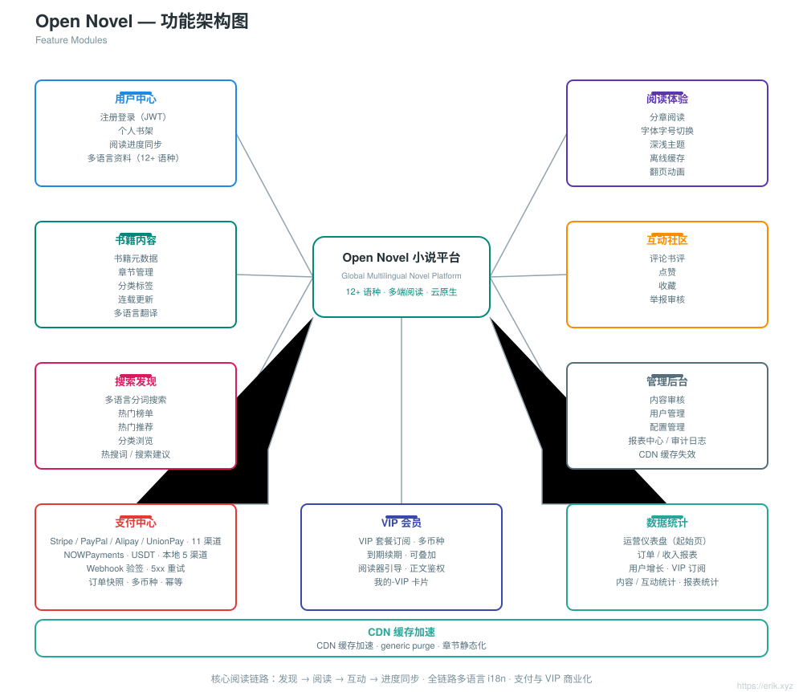
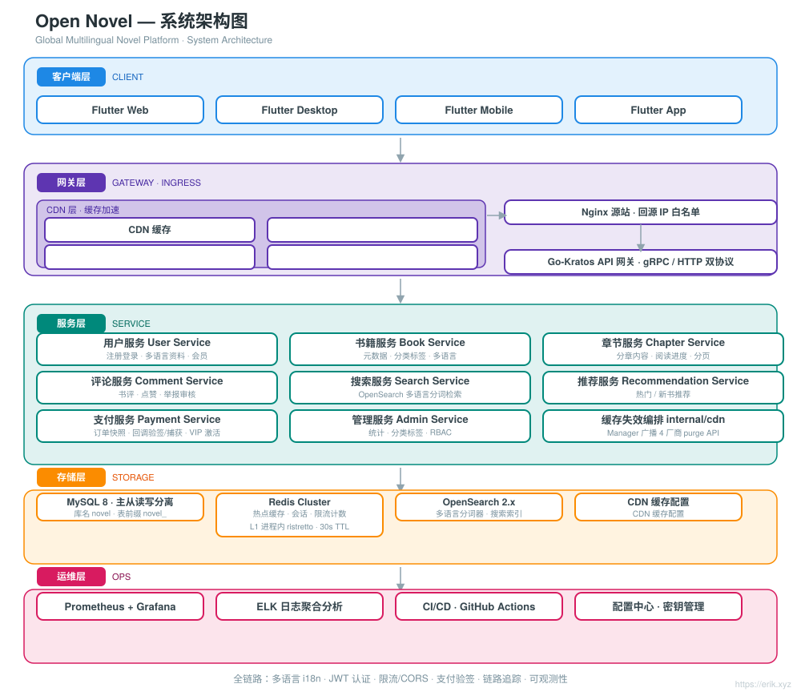
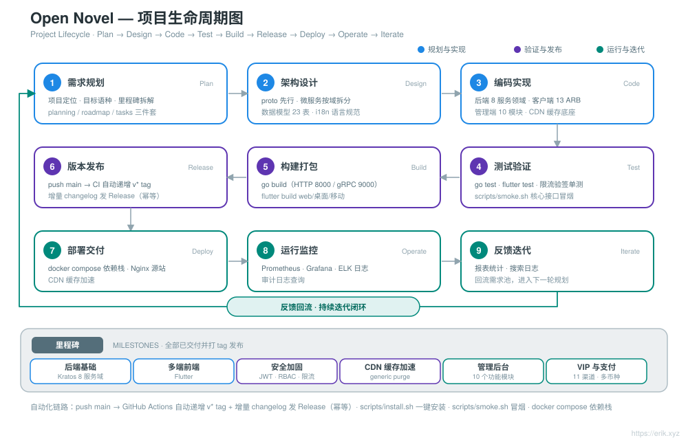
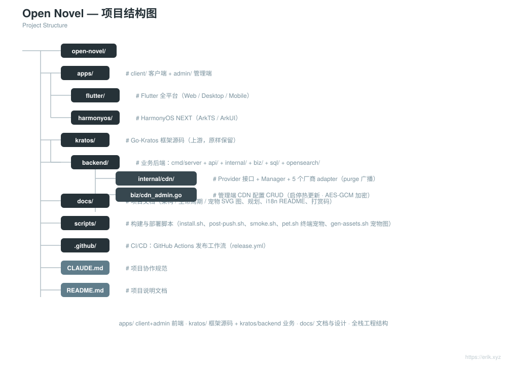

# Open Novel — 全球多语言小说平台

<div align="center">

**中文** · [English](docs/i18n/README.en.md)

</div>

> 基于 **Go-Kratos** 微服务架构 + **Flutter** 多端前端的全球多语言小说阅读平台，支持 **12+ 种主要语种**，面向全球用户提供阅读、互动、搜索与个性化推荐能力。


---

## 项目简介

Open Novel 是一个云原生微服务架构的全球多语言小说平台：

- **后端**：Go-Kratos v2（gRPC / HTTP 双协议），微服务按领域拆分（用户、书籍、章节、评论、搜索、推荐）
- **前端**：Flutter 全平台（Web / Desktop / Mobile），共用同一套后端 API
- **多语言**：i18n 资源动态加载，支持 12+ 语种（中文、英文、日文、韩文、法文、德文、西班牙文、俄文、阿拉伯文等）
- **存储**：MySQL 8（主从读写分离）+ Redis（热点缓存 / 会话）+ ristretto（进程内 L1 二级缓存）+ OpenSearch（多语言搜索）
- **运维**：Docker Compose 一键部署，Prometheus + Grafana 监控，GitHub Actions 持续集成

## 功能特性

<p align="center"></p>

- **用户中心**：注册登录（JWT）、个人书架、阅读进度跨端同步、多语言个人资料
- **阅读体验**：分章阅读、字体字号切换、深浅主题、离线缓存、翻页动画
- **书籍内容**：书籍元数据、章节管理、分类标签、连载更新、多语言翻译
- **互动社区**：评论书评、点赞、收藏、举报审核
- **搜索发现**：多语言分词搜索、热搜词榜（/api/search/hot-keywords）、搜索建议（/api/search/suggest，本地历史 20 条可清空 + 200ms 防抖）、热门榜单、分类浏览
- **管理后台**：内容审核、用户管理、数据统计（仪表盘 / DAU / 榜单）、配置管理（分类标签）、机器翻译工作流（DeepL，/api/admin/translate/*，管理端「翻译」页 + 人工编辑）、审计日志查询（/api/admin/audit-logs）
- **支付与会员**：11 个支付渠道（国际卡 Stripe / PayPal + USDT NOWPayments + 本地 Razorpay(hi) / KOMOJU(ja) / PortOne(ko) / Mercado Pago(pt-BR) / Xendit(id/th/vn) / Alipay(zh-CN) / WeChat Pay Global(国际版) / UnionPay(zh-CN)）、VIP 套餐订阅与续期、支付方式多语言路由

## 系统架构

<p align="center"></p>

整体为 Go-Kratos 微服务架构：Flutter 客户端经 CDN 缓存 + Nginx（TLS / 静态资源 / 反向代理）与 API 网关交互，网关按领域路由到用户、书籍、章节、评论、搜索、推荐等后端服务；数据层为 MySQL 主从（读写分离）+ Redis 缓存（其上叠加 ristretto 进程内 L1 二级缓存）+ OpenSearch 搜索索引。服务间 gRPC 通信，对外 HTTP 接口统一前缀 `/api`。

其余设计图：项目全景 [docs/project.svg](docs/project.svg) · 请求周期 [docs/request-cycle.svg](docs/request-cycle.svg) · 安全架构 [docs/security.svg](docs/security.svg) · 项目结构 [docs/structure.svg](docs/structure.svg) · 项目生命周期 [docs/lifecycle.svg](docs/lifecycle.svg)。

## 项目生命周期

<p align="center"></p>

从**规划 → 架构设计 → 编码 → 测试 → 构建 → 发布 → 部署 → 监控 → 迭代**九个环节串成闭环：规划落地在 `planning / roadmap / tasks` 三件套；发布环节由 GitHub Actions 在 push `main` 后自动递增 `v*` tag 并以增量 changelog 创建 Release（幂等）；迭代环节把报表统计与搜索数据回流到需求池，进入下一轮规划。底部为已交付里程碑（后端基础 / 多端前端 / 安全加固 / 缓存加速 / 管理后台 / VIP 与支付）。


<!-- assets-license:start -->
## 视觉资产授权 / Visual Assets License

本项目的图片、图标（包括 `docs/` 下的 SVG / PNG 图）**不是开源资产**，版权归作者所有。未经书面许可不得复制、修改、再分发或
用于商业用途；商业使用需取得商业授权，联系 **erik@erik.xyz**。详见
[ASSETS-LICENSE.md](ASSETS-LICENSE.md)。

> 代码部分仍遵循仓库原有 `LICENSE`；第三方素材（如明确标注的 Go Gopher 等）仍遵循其原许可证。
<!-- assets-license:end -->


## 项目规划

架构设计 [docs/novel-project-planning.md](docs/novel-project-planning.md) · 现状盘点与阶段路线 [docs/roadmap.md](docs/roadmap.md) · 详细任务分解 [docs/tasks.md](docs/tasks.md) · 支付渠道上线配置 [docs/merchant-config.md](docs/merchant-config.md)。

## 目录结构

```
open-novel/
├─ apps/                     # 多端前端
│  ├─ client/                #   客户端（C 端）
│  │  ├─ flutter/            #     Flutter 全平台（Web / Desktop / Mobile），i18n 多语言
│  └─ admin/                 #   管理端（Flutter Web，B 端后台）
├─ .github/                  # CI/CD：GitHub Actions 发布工作流（release.yml）
├─ kratos/                   # Go-Kratos 框架源码（上游框架，原样保留，勿改）
│  └─ backend/               #   本项目业务后端：cmd/server 入口 + api/ + internal/ + sql/ + opensearch/
├─ docs/                     # 项目文档（规划、架构 / 生命周期等 SVG 图、i18n README、打赏码）
├─ scripts/                  # 构建与部署脚本（install.sh 一键安装、post-push.sh 自动发布、smoke.sh）
├─ docker-compose.yml        # 本地依赖栈：MySQL 8 + Redis 7 + OpenSearch 2
├─ CLAUDE.md                 # 项目协作规范
└─ README.md                 # 项目说明文档
```

<p align="center"></p>

> 注意：`kratos/` 是 Kratos 框架源码（自带 README / LICENSE），业务代码全部在 `kratos/backend/`。

## 技术栈

| 层次 | 技术选型 |
| :--- | :--- |
| 客户端 | Flutter（Web / Desktop / Mobile，url_launcher / flutter_cache_manager） |
| 管理端 | Flutter Web（`apps/admin/`，B 端后台） |
| 网关 | Nginx + CDN 缓存（generic purge）、Go-Kratos API 网关（gRPC / HTTP 双协议） |
| 服务端 | Go 1.22+、Kratos v2、protobuf / gRPC、stripe-go（Stripe 支付 SDK） |
| 存储 | MySQL 8.0（主从）、Redis 7.x（Cluster）、ristretto（进程内 L1 二级缓存，128MB / 30s TTL）、OpenSearch 2.x |
| 可观测 | Prometheus、Grafana、ELK、OpenTelemetry 链路追踪 |
| 运维 | Docker Compose、GitHub Actions CI/CD |

## 数据库

- 数据库名：`novel`
- 表前缀：`novel_`（如 `novel_user`、`novel_book`、`novel_chapter`、`novel_comment`、`novel_payment_order`、`novel_payment_provider`、`novel_vip_order`、`novel_vip_plan`、`novel_audit_log` 等）

```sql
CREATE DATABASE novel DEFAULT CHARACTER SET utf8mb4 COLLATE utf8mb4_unicode_ci;
```

建表脚本：`kratos/backend/sql/init.sql`（Docker Compose 首次启动自动执行）。详细表设计与读写分离策略见 [docs/novel-project-planning.md](docs/novel-project-planning.md)。

## API 文档

接口统一前缀 `/api`，版本经请求头 `X-Api-Version: v1` 协商（不写在 URL 中）。完整端点、参数、错误码与限流说明见 **[docs/api.md](docs/api.md)**。按领域分组：

| 领域 | 示例路由 | proto 定义 |
| :--- | :--- | :--- |
| 用户 | `/api/users` 等 | `kratos/backend/api/user/v1` |
| 书籍 | `/api/books`、`/api/books/{id}`、`/api/categories`、`/api/tags` | `kratos/backend/api/book/v1` |
| 章节 | `/api/...` | `kratos/backend/api/chapter/v1` |
| 评论 | `/api/...` | `kratos/backend/api/comment/v1` |
| 搜索 | `/api/search/hot-keywords`（热搜词榜）、`/api/search/suggest`（搜索建议）、`/api/search/hot` 等 | `kratos/backend/api/search/v1` |
| 推荐 | `/api/...` | `kratos/backend/api/recommendation/v1` |
| 支付 | `/api/payments/...` | `kratos/backend/api/payment/v1` |
| 管理 | `/api/stats/overview`、`/api/categories`、`/api/tags`、`/api/admin/audit-logs`（审计日志，分页 + 多条件筛选） | `kratos/backend/api/admin/v1` |

详细路由见各 proto 文件 `option (google.api.http)` 声明。

## 快速开始

```bash
# 1. 启动依赖栈（MySQL / Redis / OpenSearch，首次启动自动执行 kratos/backend/sql/init.sql 建表）
docker compose up -d

# 2. 启动后端服务（Kratos 业务目录，HTTP :8000 / gRPC :9000）
cd kratos/backend && go mod tidy && go run ./cmd/server

# 3. 启动 Flutter 端（默认连 localhost:8000，无需额外配置）
cd apps/client/flutter && flutter pub get && flutter run -d chrome
```

- 依赖栈端口映射：MySQL `3307`、Redis `6380`、OpenSearch `9200`（宿主机 3306/6379 被本机服务占用，见 docker-compose.yml 注释）。
- 后端地址与密钥在 `kratos/backend/config/` 配置，支持环境变量覆盖（如 `PORT`、`OPENSEARCH_ADDR`）。
- Flutter 连其他后端：`flutter run -d chrome --dart-define=API_BASE_URL=http://<host>:8000`。

详见 [apps/README.md](apps/README.md) 与 [apps/client/flutter/README.md](apps/client/flutter/README.md)。

## 一键安装

```bash
bash scripts/install.sh
```

一条命令完成环境检查 + 依赖栈启动 + 启动提示：检查 Docker / Go ≥ 1.22 / Flutter 是否安装（缺失时给出安装提示）、`docker compose up -d` 启动依赖栈、等待 MySQL 就绪（最多 60 秒）、最后打印后端与三个前端的启动命令和访问地址。可重复执行（幂等）；`bash scripts/install.sh --skip-deps` 跳过依赖栈步骤。

## 安装说明

- **前置依赖**：Docker（含 Compose 插件）、Go 1.22+、Flutter 3.x
- **一键方式**：运行 `bash scripts/install.sh`，按脚本提示完成环境检查与依赖栈启动
- **手动方式**（与脚本步骤等价，亦见上文「[快速开始](#快速开始)」）：

  ```bash
  docker compose up -d                                     # 依赖栈：MySQL / Redis / OpenSearch（首次启动自动执行 init.sql 建表）
  cd kratos/backend && go mod tidy && go run ./cmd/server  # 后端 HTTP :8000 / gRPC :9000
  cd apps/client/flutter && flutter pub get && flutter run -d chrome  # 客户端
  ```

## 使用说明

- **后端**：HTTP `http://localhost:8000`（gRPC `:9000`），接口统一前缀 `/api`，版本经请求头 `X-Api-Version: v1` 协商
- **客户端**：`cd apps/client/flutter && flutter pub get && flutter run -d chrome`（默认连 localhost:8000）
- **管理端**：`cd apps/admin && flutter pub get && flutter run -d chrome`，端口由 Flutter 随机分配并打印在控制台（可用 `--web-port` 固定）
- **依赖栈端口映射**：MySQL `3307`、Redis `6380`、OpenSearch `9200`
- **默认配置**：`kratos/backend/config/`（数据库连接、密钥、端口），支持环境变量覆盖
- **常见问题**：
  - 端口占用：`lsof -i :8000` 定位占用进程，或修改 `kratos/backend/config/` 中端口后重启后端
  - 数据库连接失败：`docker compose ps` 确认 mysql 为 healthy；首次启动需等待 `init.sql` 建表完成

## 发布流程

- **自动**：推送 `main` 后 GitHub Actions（[.github/workflows/release.yml](.github/workflows/release.yml)）自动基于最新 `v*` tag 递增 patch 版本，创建 tag 并推送，再以增量 changelog 创建 GitHub Release；HEAD 已带版本 tag 时跳过。首次发布从 `v1.0.0` 起。
- **手动兜底**：运行 [scripts/post-push.sh](scripts/post-push.sh)（需 `gh` 已认证）：`echo "x y refs/heads/main z" | scripts/post-push.sh`。
- **手动**：

  ```bash
  git tag -a v1.0.1 -m "release v1.0.1"
  git push origin v1.0.1
  gh release create v1.0.1 --generate-notes
  ```

## 路线图

| 阶段 | 周期 | 任务重点 | 状态 |
| :--- | :--- | :--- | :--- |
| Phase 1 | 2-3 周 | Kratos 后端基础服务 + MySQL / Redis / OpenSearch 集成 | ✅ 已完成 |
| Phase 2 | 3-4 周 | Flutter 多端前端 + 多语言 ARB 编写 | ✅ 已完成 |
| Phase 3 | 2 周 | 安全加固（JWT / RBAC / 限流）+ 压力测试 | ✅ 已完成 |
| Phase 4 | 1-2 周 | 全链路联调 + 缓存与静态资源加速 | ✅ 已完成 |
| Phase 5 | 持续 | 搜索与推荐体验优化 | ⏳ 进行中 |
| 商业化 | 2026-08 | 管理后台（审核/用户/统计/配置/审计日志）、多语言与阅读体验、VIP 与支付链（11 渠道，支付宝 / 微信支付国际版 / 银联 2026-08-29 接入） | ✅ 已完成（T-A-01~17 / T-C-01~23 / T-P-01~22） |

## 支持与打赏

如果这个项目对你有帮助，欢迎 **Star**、**Fork** 支持；也欢迎扫码打赏，你的每一份支持都是我持续维护与更新的动力，感谢你的鼓励！

<div align="center">

**微信赞赏** ｜ **支付宝赞赏**

　

</div>

## 开源版 vs 商业版

本仓库是面向个人学习、研究的开源版；商业版由作者单独提供，在同一代码基线上扩展了多厂商 CDN、行为分析、AI 推荐、Novi 宠物子系统与 HarmonyOS 原生客户端，并包含更完整的自动化测试。两版共用同一套 API 与账号/阅读主链路，商业版是开源版的超集。

| 维度 | 开源版（本仓库） | 商业版 |
| :--- | :--- | :--- |
| 定位 | 个人学习、研究、二次开发 | 面向商业运营的完整交付版 |
| Go 代码（非测试） | 约 2.55 万行 | 约 2.91 万行 |
| 后端服务（proto service） | 8 个 | 10 个（新增 Behavior、Cdn） |
| RPC 接口 | 70 个 | 78 个 |
| 数据表 | 22 张 | 23 张（新增 `novel_cdn_provider`） |
| 管理端页面 | 16 个 | 18 个（新增行为分析、CDN 厂商管理） |
| 客户端 | Flutter（9 个页面） | Flutter + HarmonyOS 原生（15 个 ArkTS 页面） |
| 自动化测试 | 23 个测试文件 | 34 个测试文件 |
| 授权 | 仅个人学习/研究，商业使用需书面授权 | 商业授权与交付条款请联系 **erik@erik.xyz** |

### 多维度对比

| 维度 | 开源版（本仓库） | 商业版 |
| :--- | :--- | :--- |
| 功能覆盖 | 8 个 proto service、70 个 RPC、22 张表、16 个管理端页面；Flutter 客户端 9 页 | 10 个 proto service、78 个 RPC、23 张表、18 个管理端页面；Flutter + HarmonyOS 15 页；新增多 CDN、行为分析、AI 推荐、Novi 宠物 |
| 安全防护 | JWT/OptionalAuth、限流、Security、RawBody、API 版本中间件；RBAC、审计、加密逻辑 | 同一套中间件链与安全逻辑（`internal/middleware` 文件一致）；新增 Behavior/Cdn 接口沿用相同 JWT、限流与安全中间件，未新增独立安全层 |
| 性能与规模 | Go-Kratos + MySQL + Redis + OpenSearch；单服务端多模块 | 同一技术栈与部署形态；增加 AI 推荐缓存与多 CDN 缓存失效/预热能力，无架构级差异 |
| 数据与检索 | 22 张表；OpenSearch 全文检索 + MySQL 主数据 | 23 张表（新增 `novel_cdn_provider`）；同样使用 OpenSearch + MySQL，另有多厂商 CDN 管理 |
| 测试与质量 | 23 个 Go 测试文件 / 70 个测试函数；覆盖 biz/service/data/middleware/cdn/pkg | 34 个测试文件 / 107 个测试函数；新增模块带对应测试。两版均只有 release 工作流，没有自动测试门禁 |
| 部署与运维 | Docker Compose：MySQL、Redis、OpenSearch；Kratos 服务端 + Flutter 构建脚本 | 同一套 Compose 与 Kratos 服务端；新增 Behavior/Cdn 模块随主服务部署；额外提供 HarmonyOS 打包 |
| 多端与国际化 | Flutter 客户端 9 页 + 管理端 16 页；13 个 ARB 语言包 | Flutter 客户端 9 页 + 管理端 18 页；13 个 ARB 语言包；另有 HarmonyOS 15 页及对应多语言资源 |
| 扩展性与二次开发 | Kratos 分层（api/biz/data/service/middleware），8 个 proto service；新增模块按同一 proto + service 模式扩展 | 同一套分层与扩展方式，10 个 proto service / 78 RPC；Behavior、Cdn 可直接作为新增模块的参考实现 |
| 授权与商业支持 | LICENSE 仅限个人学习/研究，商业使用需书面授权 | LICENSE 文本与开源版一致；商业授权、交付与支持条款请联系 **erik@erik.xyz** |
| 适用场景 | 个人学习、研究、二次开发；Flutter 单端自建 | 商业运营、内容平台交付；需要多 CDN、行为分析、AI 推荐、HarmonyOS 原生端与更大测试覆盖的团队 |

**商业版额外能力：**

- **多厂商 CDN 管理**：Cloudflare / CloudFront / 阿里云 / 腾讯云适配器，后台厂商配置、启停、排序与热更新，配套 `novel_cdn_provider` 表。
- **行为分析**：`/api/stats/behavior`、行为服务与后台行为分析页，补充仪表盘/DAU/榜单之外的用户行为视图。
- **AI 个性化推荐**：`strategy=ai` 本地启发式推荐与 `rec:ai:{uid}` 缓存；开源版只保留 `hot` / `new`。
- **Novi 宠物子系统**：`GET /api/pet.svg` 活体状态图、12 种表情素材、客户端/管理端组件与 PWA 图标。
- **HarmonyOS 原生客户端**：15 个 ArkTS 页面，覆盖首页、书架、阅读、评论、VIP、支付、我的、登录等流程。

**开源版保留：** 用户/书架/阅读进度、书籍/章节/分类/标签、评论点赞收藏举报、多语言搜索/热词/建议、热门榜单、11 个支付渠道、VIP 订阅、内容审核、用户管理、仪表盘/DAU/榜单、翻译工作流与审计日志，以及 Flutter 客户端和管理端。

商业版升级前请按商业版 `kratos/backend/sql/init.sql` 核对表结构；除新增表外，两版以同一代码基线演进。**商业版授权联系：erik@erik.xyz**（交付范围、部署支持与授权条款请邮件沟通）。

## 项目授权 / Project License

Copyright (c) 2026 erik <erik@erik.xyz> — https://erik.xyz

- 本项目仅供个人学习、研究使用。
- 未经作者书面授权，禁止任何形式的商业使用（包括但不限于商业部署、付费服务、二次销售、SaaS 运营及以本项目为基础提供商业服务）。
- 商业授权请联系 **erik@erik.xyz**。
- 未经授权的商业使用，作者将在全球范围内依法追究法律责任，并保留终身追责的权利。
- 第三方组件仍遵循其各自原有的许可证；视觉资产适用仓库内的 ASSETS-LICENSE.md（如适用）。

**English:** This project is provided for personal study and research only. Commercial use of any kind requires prior written authorization from the author (erik@erik.xyz). Unauthorized commercial use will be pursued for legal liability worldwide, and the author reserves the right to pursue such liability for life. Third-party components remain under their original licenses; visual assets are governed by ASSETS-LICENSE.md where applicable.

**第三方代码**：`kratos/` 为 Kratos 框架上游源码，遵循其 [MIT License](kratos/LICENSE)。

**联系方式**：GitHub Issues / PR 交流。
