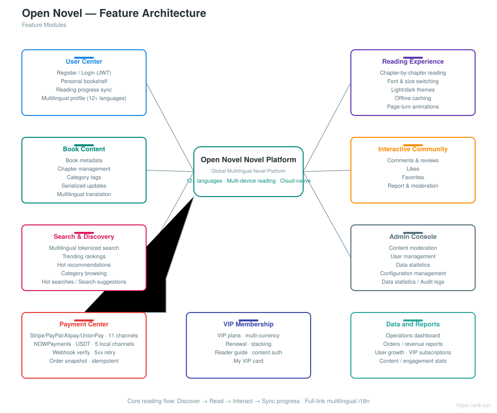
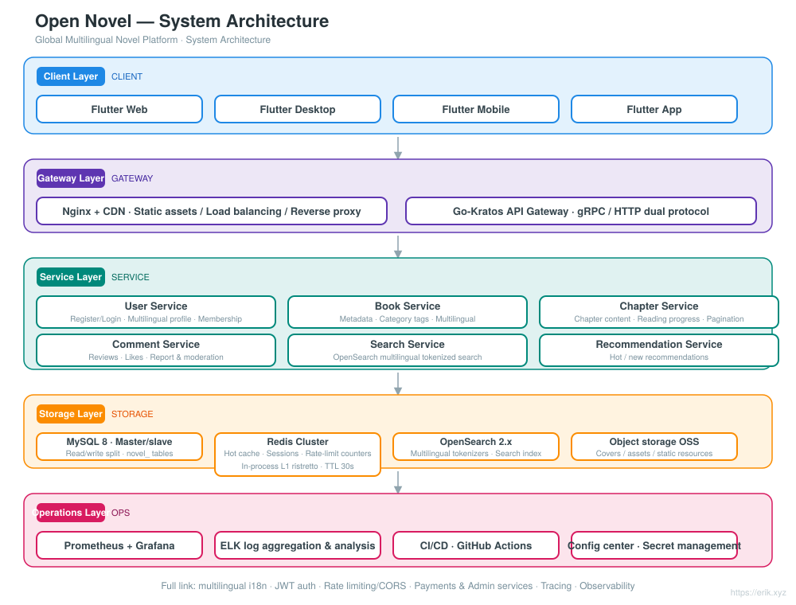
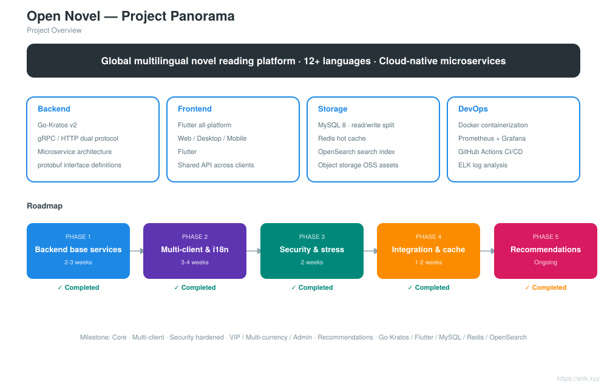
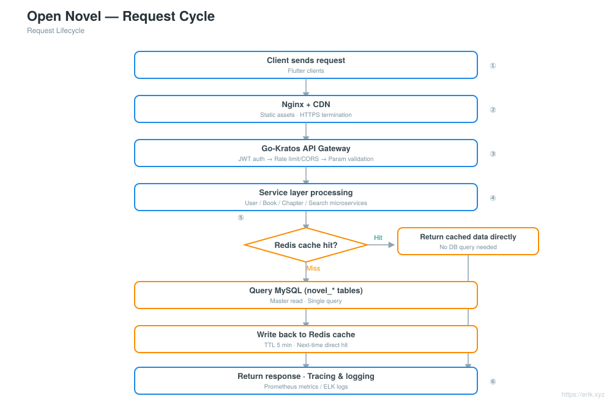
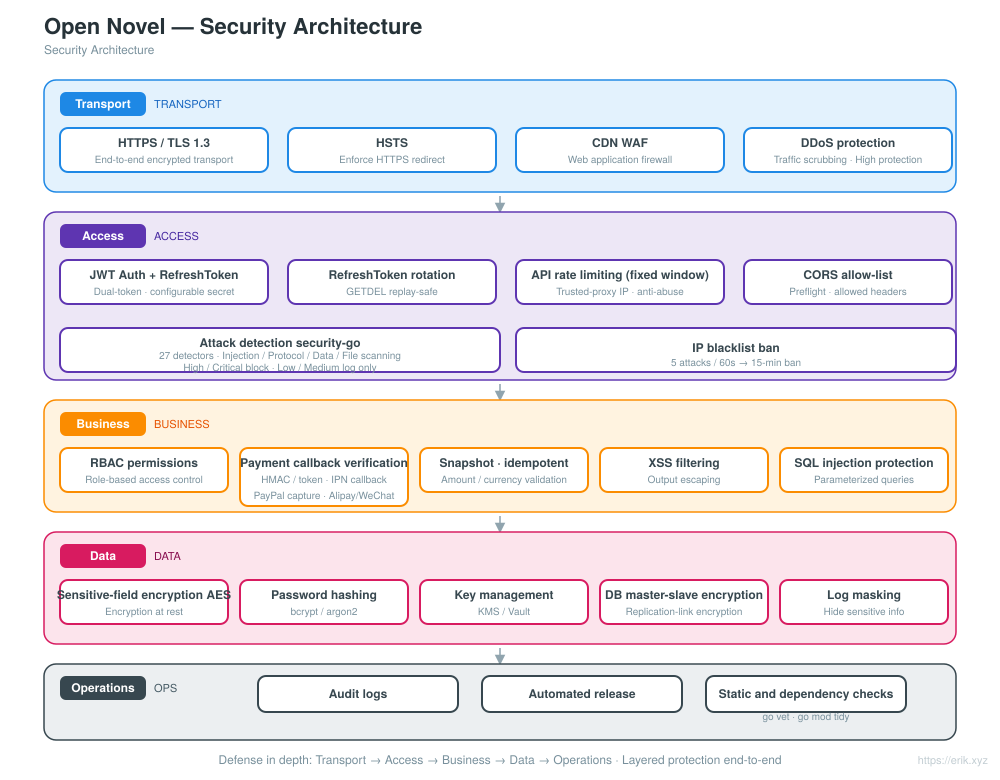
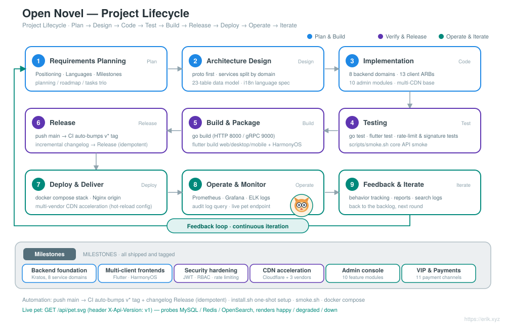
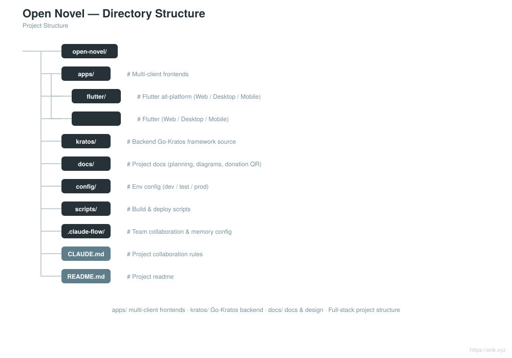

# Open Novel — Global Multilingual Novel Platform

<div align="center">

[中文](../../README.md) · **English**

</div>

> A global multilingual novel reading platform built on the **Go-Kratos** microservice architecture with **Flutter** multi-client frontends, supporting **12+ major languages** and delivering reading, interaction, search and personalized recommendation capabilities to users worldwide.


---

## Project Overview

Open Novel is a cloud-native, microservice-architecture global multilingual novel platform:

- **Backend**: Go-Kratos v2 (gRPC / HTTP dual protocol), microservices split by domain (users, books, chapters, comments, search, recommendations)
- **Frontend**: Flutter all-platform (Web / Desktop / Mobile), sharing the same set of backend APIs
- **Multilingual**: Dynamically loaded i18n resources, supporting 12+ languages (Chinese, English, Japanese, Korean, French, German, Spanish, Russian, Arabic, etc.)
- **Storage**: MySQL 8 (master-slave read/write separation) + Redis (hot cache / sessions) + OpenSearch (multilingual search)
- **Operations**: Docker Compose one-click deployment, Prometheus + Grafana monitoring, GitHub Actions continuous integration


## Features

<p align="center"></p>

- **User Center**: Registration and login (JWT), personal bookshelf, cross-device reading progress sync, multilingual profiles
- **Reading Experience**: Chapter-by-chapter reading, font and size switching, light/dark themes, offline caching, page-turn animations
- **Book Content**: Book metadata, chapter management, category tags, serialized updates, multilingual translation
- **Interactive Community**: Comments and reviews, likes, favorites, reporting and moderation
- **Search & Discovery**: Multilingual tokenized search, hot keyword rankings, search suggestions (client-side local history of 20 entries + 200 ms debounced suggestions), category browsing
- **Admin Console**: Content moderation, user management, data statistics (dashboard / DAU / rankings), configuration management (category tags), machine translation workflow (DeepL, /api/admin/translate/*, admin "Translation" page + manual editing), audit log query (/api/admin/audit-logs)
- **Payments & VIP**: Multi-channel payments via 11 providers (Stripe, NOWPayments (USDT), Razorpay, KOMOJU, PortOne, Mercado Pago, Xendit, PayPal, Alipay, WeChat Pay Global, UnionPay), VIP plan subscription and renewal, language-based payment method routing (WeChat Pay Global integrated; domestic WeChat Pay not integrated, requires CN merchant qualification)

## System Architecture

<p align="center"></p>

Overall Go-Kratos microservice architecture: Flutter clients interact with the API gateway via CDN cache + Nginx (TLS / static assets / reverse proxy); the gateway routes by domain to backend services such as users, books, chapters, comments, search and recommendations; the data layer is MySQL master-slave (read/write separation) + Redis cache + OpenSearch search index. Services communicate via gRPC, and external HTTP APIs uniformly use the `/api` prefix.

Other diagrams: project panorama [docs/project.svg](../../docs/project.svg) · request cycle [docs/request-cycle.svg](../../docs/request-cycle.svg) · security architecture [docs/security.svg](../../docs/security.svg) · project structure [docs/structure.svg](../../docs/structure.svg). · project lifecycle [docs/lifecycle.svg](../../docs/lifecycle.svg)

## Project Panorama

<p align="center"></p>

## Request Cycle

<p align="center"></p>

## Security Architecture

<p align="center"></p>

## Project Lifecycle

<p align="center"></p>

Nine steps — plan, design, code, test, build, release, deploy, operate, iterate — and feedback always flows back into the next planning round.

## Directory Structure

```
open-novel/
├─ apps/                     # Multi-client frontends
│  ├─ flutter/               #   Flutter all-platform (Web / Desktop / Mobile), i18n multilingual
├─ kratos/                   # Go-Kratos framework source (upstream framework, keep as-is, do not modify)
│  └─ backend/               #   Business backend of this project: cmd/server entry + api/ + internal/ + sql/ + opensearch/
├─ docs/                     # Project documentation (planning, architecture diagrams, i18n READMEs, reward QR codes)
├─ scripts/                  # build & deploy scripts (post-push.sh auto release, install.sh, smoke.sh)
├─ docker-compose.yml        # Local dependency stack: MySQL 8 + Redis 7 + OpenSearch 2
├─ CLAUDE.md                 # Project collaboration conventions
└─ README.md                 # Project documentation
```

<p align="center"></p>

> Note: `kratos/` is the Kratos framework source (with its own README / LICENSE); all business code lives in `kratos/backend/`.

## Tech Stack

| Layer | Technology |
| :--- | :--- |
| Client | Flutter (Web / Desktop / Mobile) |
| Gateway | Nginx + CDN cache (generic purge), Go-Kratos API Gateway (gRPC / HTTP dual protocol) |
| Server | Go 1.22+, Kratos v2, protobuf / gRPC |
| Storage | MySQL 8.0 (master-slave), Redis 7.x (Cluster), OpenSearch 2.x, ristretto in-process L1 cache on top of Redis (30 s TTL) |
| Observability | Prometheus, Grafana, ELK, OpenTelemetry tracing |
| Operations | Docker Compose, GitHub Actions CI/CD |

## Database

- Database name: `novel`
- Table prefix: `novel_` (e.g. `novel_user`, `novel_book`, `novel_chapter`, `novel_comment`, etc.)

```sql
CREATE DATABASE novel DEFAULT CHARACTER SET utf8mb4 COLLATE utf8mb4_unicode_ci;
```

Table creation script: `kratos/backend/sql/init.sql` (automatically executed on the first Docker Compose startup). For detailed table design and the read/write separation strategy, see [docs/novel-project-planning.md](../novel-project-planning.md).

## API Prefix

Backend HTTP APIs uniformly start with `/api`; the version is negotiated via the `X-Api-Version: v1` request header (not in the URL). Endpoints are grouped by domain:

| Domain | Example routes | proto definition |
| :--- | :--- | :--- |
| User | `/api/users`, etc. | `kratos/backend/api/user/v1` |
| Book | `/api/books`, `/api/books/{id}`, `/api/categories`, `/api/tags` | `kratos/backend/api/book/v1` |
| Chapter | `/api/...` | `kratos/backend/api/chapter/v1` |
| Comment | `/api/...` | `kratos/backend/api/comment/v1` |
| Search | `/api/...` | `kratos/backend/api/search/v1` |
| Recommendation | `/api/...` | `kratos/backend/api/recommendation/v1` |

For detailed routes, see the `option (google.api.http)` declarations in each proto file.

## Quick Start

```bash
# 1. Start the dependency stack (MySQL / Redis / OpenSearch; the first startup automatically executes kratos/backend/sql/init.sql to create tables)
docker compose up -d

# 2. Start the backend service (Kratos business directory, HTTP :8000 / gRPC :9000)
cd kratos/backend && go mod tidy && go run ./cmd/server

# 3. Start the Flutter client (defaults to localhost:8000, no extra configuration needed)
cd apps/client/flutter && flutter pub get && flutter run -d chrome
```

- Dependency stack port mapping: MySQL `3307`, Redis `6380`, OpenSearch `9200` (host ports 3306/6379 are occupied by local services, see docker-compose.yml comments).
- Backend address and secrets are configured in `kratos/backend/config/`, with environment variable overrides (e.g. `PORT`, `OPENSEARCH_ADDR`).
- To connect Flutter to another backend: `flutter run -d chrome --dart-define=API_BASE_URL=http://<host>:8000`.

See [apps/README.md](../../apps/README.md) and [apps/client/flutter/README.md](../../apps/client/flutter/README.md).

## One-Click Installation

```bash
bash scripts/install.sh
```

A single command completes the environment check, dependency stack startup and launch hints: it checks whether Docker / Go ≥ 1.22 / Flutter are installed (printing installation hints if anything is missing), runs `docker compose up -d` to start the dependency stack, waits for MySQL to become ready (up to 60 seconds), then prints the startup commands and access addresses for the backend and all three frontends. The script is idempotent and safe to re-run; `bash scripts/install.sh --skip-deps` skips the dependency stack step.

## Installation

- **Prerequisites**: Docker (with the Compose plugin), Go 1.22+, Flutter 3.x
- **One-click**: run `bash scripts/install.sh` and follow the printed hints for the environment check and dependency stack startup
- **Manual** (equivalent to the script steps):

  ```bash
  docker compose up -d                                     # dependency stack: MySQL / Redis / OpenSearch (init.sql runs on first start)
  cd kratos/backend && go mod tidy && go run ./cmd/server  # backend HTTP :8000 / gRPC :9000
  cd apps/client/flutter && flutter pub get && flutter run -d chrome  # client
  ```

## Usage

- **Backend**: HTTP `http://localhost:8000` (gRPC `:9000`), all APIs under the `/api` prefix, version negotiated via the `X-Api-Version: v1` header
- **Client**: `cd apps/client/flutter && flutter pub get && flutter run -d chrome` (defaults to localhost:8000)
- **Admin console**: `cd apps/admin && flutter pub get && flutter run -d chrome`; Flutter assigns a random port and prints it in the console (fix it with `--web-port`)
- **Dependency stack ports**: MySQL `3307`, Redis `6380`, OpenSearch `9200`
- **Default config**: `kratos/backend/config/` (database connection, secrets, ports), overridable via environment variables
- **FAQ**:
  - Port already in use: locate the process with `lsof -i :8000`, or change the port in `kratos/backend/config/` and restart the backend
  - Database connection failure: run `docker compose ps` and make sure mysql is healthy; the first startup needs to wait for `init.sql` to create the tables

## Release Process

- **Automatic**: after pushing `main`, GitHub Actions ([.github/workflows/release.yml](../../.github/workflows/release.yml)) automatically bumps the patch version based on the latest `v*` tag, creates and pushes the tag, then creates a GitHub Release with an incremental changelog; skipped if HEAD already carries a version tag. The first release starts from `v1.0.0`.
- **Manual fallback**: run [scripts/post-push.sh](../../scripts/post-push.sh) (requires authenticated `gh`): `echo "x y refs/heads/main z" | scripts/post-push.sh`.
- **Manual**:

  ```bash
  git tag -a v1.0.1 -m "release v1.0.1"
  git push origin v1.0.1
  gh release create v1.0.1 --generate-notes
  ```

## Roadmap

| Phase | Duration | Focus |
| :--- | :--- | :--- |
| Phase 1 | 2-3 weeks | Kratos backend base services + MySQL / Redis / OpenSearch integration |
| Phase 2 | 3-4 weeks | Flutter multi-client frontends + multilingual ARB authoring |
| Phase 3 | 2 weeks | Security hardening (JWT / RBAC / rate limiting) + stress testing |
| Phase 4 | 1-2 weeks | Full-link integration testing + cache / static asset acceleration |
| Phase 5 | Ongoing | Search and recommendation experience optimization |

All task chains have been completed.

## Support and Donations

If this project has helped you, feel free to **Star** and **Fork** it; you are also welcome to scan the QR codes to donate. Every bit of your support is my motivation to keep maintaining and updating the project. Thank you for your encouragement!

<div align="center">

**WeChat Reward** ｜ **Alipay Reward**

　

</div>

## Open Source vs Commercial Edition

This repository is the open-source edition for personal study and research. The commercial edition is available separately and extends the same codebase with multi-CDN management, behavior analytics, AI recommendations, the Novi pet subsystem and a native HarmonyOS client, plus a larger automated test suite.

| Dimension | Open source (this repo) | Commercial edition |
| :--- | :--- | :--- |
| Positioning | Personal study, research, secondary development | Complete edition for commercial operations |
| Go code (non-test) | ~25.5k lines | ~29.1k lines |
| Backend proto services | 8 | 10 (adds Behavior, Cdn) |
| RPCs | 70 | 78 |
| Database tables | 22 | 23 (adds `novel_cdn_provider`) |
| Admin pages | 16 | 18 (adds behavior analytics, CDN providers) |
| Clients | Flutter (9 pages) | Flutter + native HarmonyOS (15 ArkTS pages) |
| Automated tests | 23 test files | 34 test files |
| License | Personal study/research only; commercial use requires written authorization | Commercial licensing and delivery: **erik@erik.xyz** |

### Multi-dimensional comparison

| Dimension | Open source (this repo) | Commercial edition |
| :--- | :--- | :--- |
| Feature coverage | 8 proto services, 70 RPCs, 22 tables, 16 admin pages; Flutter client with 9 pages | 10 proto services, 78 RPCs, 23 tables, 18 admin pages; Flutter + HarmonyOS (15 pages); adds multi-CDN, behavior analytics, AI recommendations, Novi pet |
| Security | JWT/OptionalAuth, rate limiting, security, raw-body and API-version middleware; RBAC, audit and encryption logic | Same middleware chain and security logic (identical `internal/middleware` files); new Behavior/Cdn endpoints use the same JWT, rate-limit and security middleware; no separate security layer |
| Performance and scale | Go-Kratos + MySQL + Redis + OpenSearch; one server process hosting multiple modules | Same stack and deployment shape; adds AI recommendation cache and multi-CDN purge/preload, with no architectural difference |
| Data and search | 22 tables; OpenSearch full-text search + MySQL primary data | 23 tables (adds `novel_cdn_provider`); same OpenSearch + MySQL, plus multi-vendor CDN management |
| Testing and quality | 23 Go test files / 70 test functions across biz/service/data/middleware/cdn/pkg | 34 test files / 107 test functions; new modules include tests. Both editions only have a release workflow, with no automated test gate |
| Deployment and ops | Docker Compose: MySQL, Redis, OpenSearch; Kratos server + Flutter build scripts | Same Compose and Kratos server; Behavior/Cdn ship with the main service; additionally provides HarmonyOS packaging |
| Clients and i18n | Flutter client 9 pages + 16 admin pages; 13 ARB locales | Flutter client 9 pages + 18 admin pages; 13 ARB locales; plus HarmonyOS 15 pages and matching locale resources |
| Extensibility | Kratos layers (api/biz/data/service/middleware), 8 proto services; new modules follow the same proto + service pattern | Same layering and extension pattern, 10 proto services / 78 RPCs; Behavior and Cdn serve as reference implementations for new modules |
| License and commercial support | Personal study/research only; commercial use requires written authorization | Same LICENSE text as the open edition; commercial licensing, delivery and support: **erik@erik.xyz** |
| Fit | Personal study, research, secondary development; single-client Flutter self-hosting | Commercial operations and content-platform delivery; teams needing multi-CDN, behavior analytics, AI recommendations, native HarmonyOS and larger test coverage |

**Commercial-only capabilities:**

- **Multi-CDN management** — Cloudflare / CloudFront / Aliyun / Tencent adapters, admin configuration, enable/disable, ordering and hot reload, backed by `novel_cdn_provider`.
- **Behavior analytics** — `/api/stats/behavior`, behavior service and an admin analytics page, adding a user-behavior view on top of the dashboard/DAU/ranking reports.
- **AI recommendations** — `strategy=ai` local heuristic ranking with `rec:ai:{uid}` cache; the open-source edition keeps only `hot` / `new`.
- **Novi pet subsystem** — live `GET /api/pet.svg` status, 12 expression assets, client/admin widgets and PWA icons.
- **Native HarmonyOS client** — 15 ArkTS pages covering home, bookshelf, reader, comments, VIP, payment, profile and login.

**Retained in the open-source edition:** users/bookshelf/reading progress, books/chapters/categories/tags, comments/likes/favorites/reports, multilingual search/hot keywords/suggestions, hot rankings, 11 payment channels, VIP subscriptions, content moderation, user management, dashboard/DAU/rankings, translation workflow and audit logs, plus the Flutter client and admin console.

Before upgrading to the commercial edition, reconcile the schema against its `kratos/backend/sql/init.sql`. Both editions evolve from the same codebase apart from the added modules. **Commercial licensing: erik@erik.xyz** (delivery scope, deployment support and license terms by email).

## 项目授权 / Project License

Copyright (c) 2026 erik <erik@erik.xyz> — https://erik.xyz

- 本项目仅供个人学习、研究使用。
- 未经作者书面授权，禁止任何形式的商业使用（包括但不限于商业部署、付费服务、二次销售、SaaS 运营及以本项目为基础提供商业服务）。
- 商业授权请联系 **erik@erik.xyz**。
- 未经授权的商业使用，作者将在全球范围内依法追究法律责任，并保留终身追责的权利。
- 第三方组件仍遵循其各自原有的许可证；视觉资产适用仓库内的 ASSETS-LICENSE.md（如适用）。

**English:** This project is provided for personal study and research only. Commercial use of any kind requires prior written authorization from the author (erik@erik.xyz). Unauthorized commercial use will be pursued for legal liability worldwide, and the author reserves the right to pursue such liability for life. Third-party components remain under their original licenses; visual assets are governed by ASSETS-LICENSE.md where applicable.
